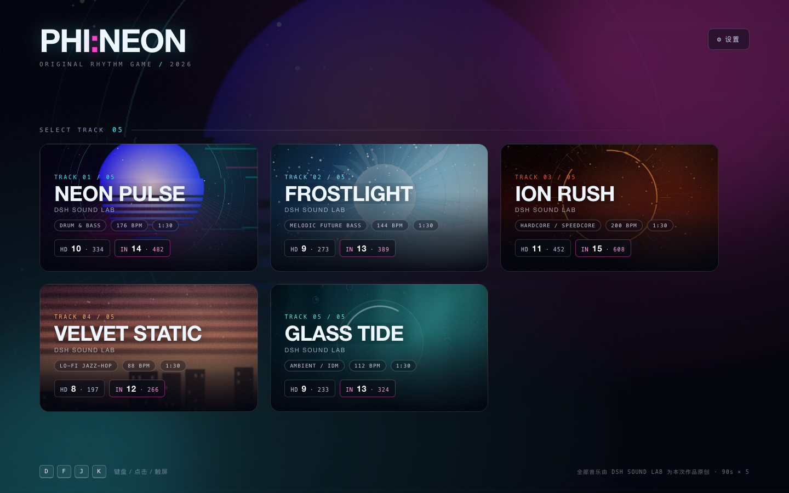
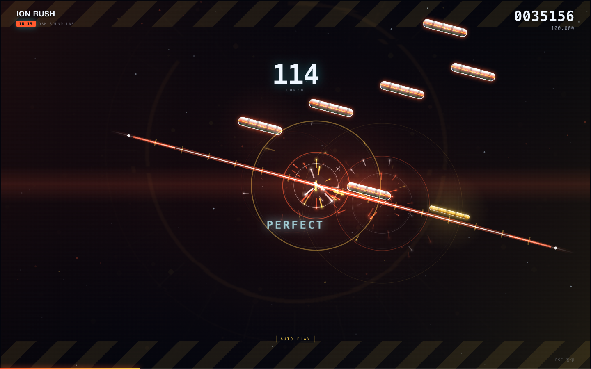
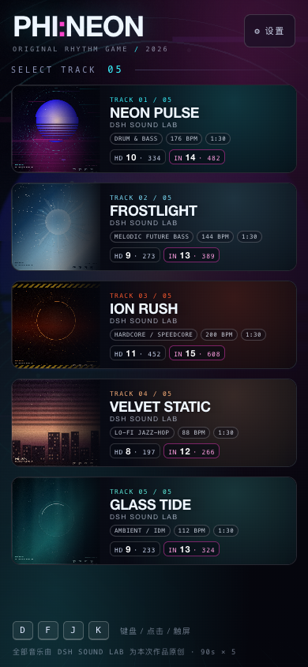

# PHI:NEON

一款向 **Phigros** 致敬的原创网页节奏游戏。五条 1:30 的原创曲目，每条曲目提供 **HD / IN** 两个难度；桌面与手机浏览器均可游玩。

> 机制、判定线演出与界面语言参考 Phigros；曲目、封面、谱面与代码均为本项目原创，不使用任何游戏素材。

## 预览







## 立即游玩

```bash
cd nexus-site/games/phi-neon
./start.sh          # 默认 8765 端口
```

浏览器打开 **http://127.0.0.1:8765**。

> 请通过本地 HTTP 服务打开，不要直接双击 `index.html`：浏览器会以 `file://` 加载，音频与封面可能被安全策略拦截。

## 曲目

| # | 曲目 | 风格 | 调性 | BPM | 时长 | 难度 | 音符（HD / IN） |
|---|------|------|------|-----|------|------|------------------|
| 01 | **NEON PULSE** | Drum & Bass / 霓虹合成器 | A 小调 | 176 | 1:30 | HD 10 · IN 14 | 334 / 482 |
| 02 | **FROSTLIGHT** | Melodic Future Bass / 冰晶氛围 | D 小调 | 144 | 1:30 | HD 9 · IN 13 | 273 / 389 |
| 03 | **ION RUSH** | Hardcore / Speedcore / 反应堆过载 | F# 小调 | 200 | 1:30 | HD 11 · IN 15 | 452 / 608 |
| 04 | **VELVET STATIC** | Lo-fi Jazz-hop / 磁带黄昏 | Eb 大调 | 88 | 1:30 | HD 8 · IN 12 | 197 / 266 |
| 05 | **GLASS TIDE** | Ambient / IDM / 深水玻璃回声 | C# 小调 | 112 | 1:30 | HD 9 · IN 13 | 233 / 324 |

五条曲子都由 `tools/make_music.py` 用 numpy/scipy 从零合成（鼓组、贝斯、Pad、Arp、Lead、侧链、混响、母带），没有采样包或第三方音频。谱面与音乐段落、鼓点、impact 对齐；每首的封面由 `tools/make_covers.py` 程序化绘制。

## 试听

- [NEON PULSE（90.000 s）](audio/neon-pulse.m4a)
- [FROSTLIGHT（90.000 s）](audio/frostlight.m4a)
- [ION RUSH（90.000 s）](audio/ion-rush.m4a)
- [VELVET STATIC（90.000 s）](audio/velvet-static.m4a)
- [GLASS TIDE（90.000 s）](audio/glass-tide.m4a)

## 玩法

- **Tap**：音符抵达判定线时点击 / 按对应键。
- **Drag**：黄色长条音符，到点自动判定，不需要额外操作。
- **Flick**：粉色箭头音符，点击或滑动均可接住。
- **Hold**：青色长条，按住直到尾部；提前松手会断连。
- 判定线会移动、倾斜、旋转，音符的落点始终跟随判定线。

### 键盘

| 按键 | 功能 |
|------|------|
| `D` `F` `J` `K` | 四条轨道 |
| `←` `↓` `↑` `→` | 方向键轨道（备用） |
| `Esc` | 暂停 / 继续 |
| `R` | 重新开始 |

### 触屏

- 直接点击判定线上的音符；Hold 按住不放；Flick 可点击或划过。
- 右下角暂停按钮；竖屏会提示“横屏体验更佳”，横屏会获得更宽的判定线。
- 难度选择、结算、设置、返回选曲均已适配 390×844 与 844×390。

## 判定与结算

| 判定 | 时间窗 | 权重 |
|------|--------|------|
| Perfect | ±45 ms | 1.00 |
| Good | ±90 ms | 0.65 |
| Bad | ±140 ms | 0.30 |
| Miss | 超过 140 ms | 0 |

总分 = `900000 × 准确率 + 100000 × (最大连击 / 总音符数)`，满分 **1,000,000**。

| 评级 | 条件 |
|------|------|
| **PHI** | 全部 Perfect |
| **FC** | 无 Miss、无 Bad |
| **S / A / B / C / F** | 分数 ≥ 950k / 900k / 800k / 700k / 其余 |

个人最佳成绩按 `曲目:难度` 存在 `localStorage`，选曲卡片会显示 BEST 徽章。

## 打击反馈

五首曲目各有一套独立的舞台演出与击打反馈，由 `js/charts.js` 里每首曲目的 `theme` 字段驱动（`bg` / `hit` / `note` / `line`）：

| 曲目 | 背景演出 | 击打特效 | 音符 / 判定线 |
|------|----------|----------|----------------|
| NEON PULSE | 向后滚动的透视霓虹网格 + 封面慢旋转 | 冲击核 + 双层扩散环 + 沿判定线光波 | 玻璃胶囊；青白霓虹线 + 两端菱形 |
| FROSTLIGHT | 五条缓慢横移的极光光帘 + 星点 | 冰晶碎片 + 十字星闪 | 斜向冰纹胶囊；结晶方框装饰线 |
| ION RUSH | 上下警戒斜纹带、上升火星、地平线脉冲 | 失重火星 + 抖动冲击 + 双层环 | 警示斜齿；琥珀刻度齿线 + 橙段 |
| VELVET STATIC | 暖色光带、尘点、4px 扫描线、颗粒噪点 | 柔和光尘团（无强闪白） | 暖色渐变；双细线 |
| GLASS TIDE | 正弦焦散光带、上浮气泡、底部水光 | 三层延迟涟漪 + 气泡上升 | 同心贝壳纹；正弦浮动点线 |

- **命中粒子**：白色冲击核、扩散环、沿判定线扫过的光波、放射光刃、碎片、十字星与余烬；按 Tap / Drag / Flick / Hold 与判定等级使用不同配色。
- **打击音**：WebAudio 实时合成，音高跟随轨道位置落在当前曲目的调性内（A 小调 / D 小调 / F# 小调 / Eb 大调 / C# 小调）；Perfect 额外叠加高八度泛音、噪声瞬态与低频冲击，Good / Bad 更短更钝。
- **连击里程碑**：每 50 / 100 连击触发一次环形冲击波与上行琶音。
- 判定线在命中时会短暂增亮，粒子使用加色混合与缓存光晕，保持高密度谱面下的可读性。

## 设置

- 音乐音量
- **打击音音量**（独立于音乐，可在设置里拖动试听）
- 判定偏移（±120 ms）
- 自动演奏（AUTO，用于演示 / 录屏）
- 按键提示开关

## 目录

```
phigros-neon/
├── index.html          # 页面骨架：HUD、菜单、难度、暂停、设置、结算
├── css/style.css       # 视觉系统与响应式（桌面 / 竖屏 / 横屏）
├── js/
│   ├── charts.js       # 曲目元数据 + 十条谱面（PHINEON_CHARTS）
│   ├── engine.js       # 判定线、音符、判定、渲染、输入
│   ├── ui.js           # 菜单 / 难度 / 暂停 / 结算 / 设置 / 最佳成绩
│   ├── audio.js        # HTMLAudio 播放 + WebAudio 打击音
│   └── track-meta.js   # 由 tools 生成的曲目结构（段落/impact）
├── audio/              # 五条原创曲目（m4a, 256 kbps）
├── img/                # 五张原创封面 + favicon
├── data/track-meta.json
├── screenshots/        # 桌面 / 竖屏 / 横屏预览图
├── tools/
│   ├── make_music.py   # 作曲 / 合成 / 母带
│   └── make_covers.py  # 封面生成
└── start.sh
```

## 音频管线

全部声音由 `tools/make_music.py` 用 numpy/scipy 逐采样生成，没有任何采样包或第三方素材：

1. **分轨合成**：鼓组（三层 kick / 噪声+鼓腔 snare / 六个非谐方波的 808 金属 hi-hat）、贝斯（带滤波包络的锯齿+方波）、Pad（5 声部 ±9 音分失谐）、Lead（±15 音分双层 + 11 ms Haas 加宽）、电钢（非谐泛音 + 音叉噪声）、钟琴（FM 泛音）。
2. **鼓组处理**：鼓总线并联压缩 + 0.42 s 房间卷积（`drum_glue()`），保留瞬态的同时给鼓一点"房间"。
3. **空间**：程序化 IR 混响（20 ms 预延迟、高频更快衰减、260 Hz 以下收单声道）+ 乒乓延迟。
4. **母带**：低切 → 低频单声道化 → 三段 EQ → 软饱和 → 压缩 → RMS 归一（每首独立目标）→ 前视软限幅，真峰 0.93。
5. 五首的立体声相关度为 0.57–0.95、单声道折叠损失 ≤1.1 dB，削波率为 0。

## 已知说明

- 音频为程序化合成，听感与商业音乐有差距；可在 `tools/make_music.py` 中调整配器与混音参数重新渲染。
- 谱面是脚本按段落生成的，IN 难度峰值约 14 notes/s（ION RUSH）；如需更极端的配置可继续在 `js/charts.js` 中扩展。
- 移动端音频需要一次用户点击才能启动，进入曲目时已经由难度按钮完成解锁。
